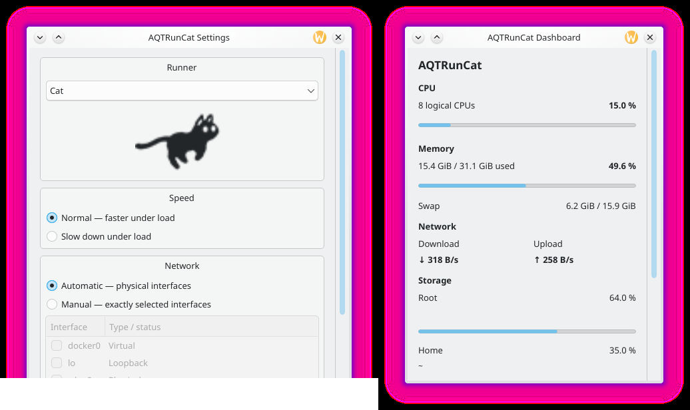

# AQTRunCat

**A Cute Run Cat for Linux.** A small animated runner lives in your system
tray and runs faster as your CPU gets busier. Click it for a Dashboard of
system metrics; add snapshot- or command-backed Custom Metrics; optionally show
up to three short values right in the tray with the Metrics Bar.

AQTRunCat is a Qt 6 application for Linux, inspired by
[RunCat Neo](https://github.com/runcat-dev/RunCatNeo) for macOS and compatible
with its runner and Custom Metrics formats. It is an independent project, not
affiliated with RunCat Neo. It uses the
standard StatusNotifierItem tray, so it needs no desktop-specific components;
the primary target is KDE Plasma 6 on Wayland.




## Features

- **CPU-driven runner**: 10 FPS when idle, up to 40 FPS at full load (or the
  reverse with "Slow down under load"). Monochrome runners follow the panel
  text colour in light and dark themes.
- **Runners**: Cat (default) and Coffee are built in; import any
  [RunCat Runner Gallery](https://github.com/runcat-dev/RunnerGallery) ZIP.
- **Dashboard**: CPU, memory, swap, network, Root/Home storage and disk
  activity, read directly from `/proc`, `/sys` and `statvfs`.
- **Custom Metrics**: keep using RunCat Neo-compatible JSON snapshots, or let
  AQTRunCat periodically run an explicitly configured executable.
- **Integrations**: Claude Code plan usage (current 5-hour session and
  current week, as on Claude Code's `/usage` screen) and Codex usage limits
  (as on Codex's `/status`), each switched on in Settings.
- **Metrics Bar** (off by default): up to 3 compact values, built-in or
  custom, as extra tray icons next to the runner.
- **Settings** window, start at login, and a command line (`aqtruncat --help`).
- **Backend and API**: the metrics run once per session in a small background
  service (`aqtruncatd`) that the tray, the `aqtruncatctl` command line and
  other programs share through a documented D-Bus API.
- **KDE Plasma 6 widget**: the same runner and metrics as a native Plasma
  widget (Plasmoid) for panels and the desktop, with a Plasma popup; it can
  replace the tray icon or sit next to it.

## Supported systems

| Distribution | Status |
|---|---|
| Arch Linux | supported: package (PKGBUILD) or installer; build, tests and desktop validated |
| Fedora 44 | supported: RPM or installer; build, tests and package validated |
| Debian 13, Ubuntu 26.04 LTS | supported: `.deb` or installer; build, tests and package validated |
| Ubuntu 24.04 LTS | **not supported** (Qt 6.4, see below) |

Desktops: KDE Plasma 6 Wayland is the reference. Other trays implementing
StatusNotifierItem/AppIndicator (validated: waybar) and classic X11 trays
(validated: stalonetray) work with the limitations listed below. Pure GNOME
has no tray; AQTRunCat keeps running but is not visible there without an
AppIndicator extension.

> [!WARNING]
> **Ubuntu 24.04 LTS is not supported.** It ships Qt 6.4.2, while AQTRunCat
> requires **Qt 6.5 or newer**; CMake stops with "Could not find a
> configuration file for package Qt6 that is compatible with requested version
> 6.5" and the installer reports the same. Qt 6.5 is the oldest Qt 6
> long-term-support release AQTRunCat builds and tests against. Use Ubuntu
> 26.04 LTS or newer, or another distribution with Qt ≥ 6.5.

## Install

### With the installer (any supported distribution)

From the source tree, as your normal user:

```bash
./install.sh            # system-wide into /usr/local, start at login
./install.sh --local    # only for you, no root: ~/.local/bin, ~/.local/share
```

The installer checks the build requirements (and prints the exact package
command for Arch, Fedora or Debian/Ubuntu if something is missing), builds a
Release binary from scratch in `~/.cache/aqtruncat/install-build` (emptied
first and kept afterwards) and installs it. A full build takes a minute or
two; to install that same build again without compiling, use `--no-build`
(it is refused, and nothing is installed, if the build is missing, from
another source tree, not Release, or older than the sources). A system-wide install
uses `sudo` only to copy the files; `--local` never uses it. If `sudo` refuses
after the build (for example an expired password), the installer asks whether
to retry (after you fix it, e.g. with `passwd` in another terminal) instead of
starting over; answering N changes nothing, and `--no-build` installs the
kept build later. Running it again
updates the installation in place.

| Option | Meaning |
|---|---|
| *(none)* | install system-wide (`--prefix=DIR`, default `/usr/local`) |
| `--local` | install for the current user (XDG directories, no root) |
| `-A`, `--autostart=true` | start at login (**the default**) |
| `-na`, `--autostart=false` | do not start at login |
| `-U`, `--uninstall` | uninstall (add `--local` for a local installation) |
| `--plasmoid` / `--no-plasmoid` | install the KDE Plasma 6 widget even outside Plasma (fails, with the packages to install, if Plasma 6's QML modules are missing) / never install it; by default it is installed when Plasma 6 is found |
| `--no-build` | install the existing build in `~/.cache/aqtruncat/install-build` without compiling (must be up to date); if it is another AQTRunCat version than the sources, you are asked whether to install that previous version (y) or build the new one (N, default) |
| `--dry-run` | show what would happen (every run starts with a summary of the effective options) |
| `-h`, `--help` | full help |

Start at login is a per-user preference, also for a system-wide install: it is
the XDG entry `~/.config/autostart/aqtruncat.desktop`, the same one the
Settings window and `aqtruncat autostart enable|disable` manage.

Uninstalling removes exactly the files the installer recorded, plus your
autostart entry if it starts that installation. **Your settings
(`~/.config/AQTRunCat`), user runners and Custom Metrics
(`~/.local/share/AQTRunCat`) are always kept.**

```bash
./install.sh --local -U        # remove the --local installation
./install.sh -U                # remove the system-wide installation
```

If `~/.local/bin` is not in your `PATH`, the installer says so; the menu
entry and autostart use the full path, and your shell files are never edited.

**A running AQTRunCat is closed first.** Before an update replaces files, or
an uninstall removes them, the installer sends SIGTERM (the same clean exit as
*Quit AQTRunCat*) to your AQTRunCat processes whose executable is exactly that
installation's `bin/aqtruncat` (tray) or `bin/aqtruncatd` (backend), and
waits up to 10 seconds. Nothing is matched
by name, so Claude Code, other programs and an AQTRunCat started from another
location are never touched. If it does not exit in time, the installer stops
with an error and changes nothing; it never kills it. The build, the checks
and the `sudo` password all come before this step, so a failed build leaves
your running AQTRunCat alone. It is not restarted afterwards: start it again
from the menu. `--dry-run` shows which process would be closed. With `sudo`,
other users' instances of a system-wide installation are reported but not
stopped.

### As a distribution package

Recipes for native packages are in [`packaging/`](packaging/):

| Format | Build |
|---|---|
| Arch (`PKGBUILD`) | `packaging/make-source-tarball.sh packaging/arch && cd packaging/arch && makepkg -si` |
| Fedora (RPM) | `packaging/make-source-tarball.sh ~/rpmbuild/SOURCES && rpmbuild -ba packaging/rpm/aqtruncat.spec` |
| Debian/Ubuntu (`.deb`) | extract the source tarball, copy `packaging/debian` to `debian/`, run `dpkg-buildpackage -us -uc -b` |

Flatpak and AppImage are not provided yet; the reasons are in
[docs/M9-packaging-installation.md](docs/M9-packaging-installation.md).

### Build manually

Requirements: CMake ≥ 3.21, a C++20 compiler, Qt ≥ 6.5 (Core, DBus, Widgets;
Test for the test suite), libarchive ≥ 3.0, and an installed font.

| Distribution | Development packages |
|---|---|
| Arch Linux | `cmake ninja gcc qt6-base qt6-wayland libarchive` |
| Fedora | `cmake ninja-build gcc-c++ qt6-qtbase-devel qt6-qtwayland libarchive-devel` |
| Debian 13 / Ubuntu 26.04 | `cmake ninja-build g++ qt6-base-dev qt6-wayland libarchive-dev libgl-dev` |

```bash
cmake -S . -B build
cmake --build build
ctest --test-dir build
cmake --install build            # honours CMAKE_INSTALL_PREFIX and DESTDIR
```

`-DBUILD_TESTING=OFF` skips the tests. At run time AQTRunCat needs the Qt 6
libraries, libarchive, a D-Bus session bus (every Linux desktop session has
one) and, for native Wayland windows, the Qt Wayland plugin (`qt6-wayland` /
`qt6-qtwayland`); without it Qt uses XWayland. The test suite also needs
`dbus-run-session` (package `dbus`).

## Using AQTRunCat

Start it from the application menu or with `aqtruncat`. Left-click the
runner to show or hide the Dashboard; right-click for Settings and Quit.

```bash
aqtruncat                       # start the tray runner
aqtruncat runner list           # bundled and user runners
aqtruncat runner import beagle-frames.zip
aqtruncat metrics --watch       # metrics on the terminal
aqtruncat autostart status      # enable | disable | status
aqtruncat -v                    # version (also aqtruncatd, aqtruncatctl, adapters)
```

### Backend and command line

The tray application is a client: the metrics, Custom Metrics, the Claude
Code and Codex integrations, the runner speed and the settings live in the
backend `aqtruncatd`. It starts automatically when the tray (or any other
client) needs it, runs once per session, and keeps running until you log out,
also when the tray is closed. `aqtruncatctl` reads and controls the same
backend from a terminal or a script:

```bash
aqtruncatctl status                          # backend, runner, integrations
aqtruncatctl metrics                         # every metric, human-readable
aqtruncatctl --json metrics cpu memory       # the API's JSON, for scripts
aqtruncatctl watch                           # follow changes (Ctrl+C)
aqtruncatctl settings set speedMode slow-down
aqtruncatctl integration enable codex
```

Exit status: 0 success, 1 backend failure, 2 invalid command line, 3 backend
unavailable, 4 request rejected. The D-Bus API
(`io.github.psykedady.AQTRunCat1` on the session bus), its JSON schema and a
small Python client are documented in
[docs/F4.1-headless-backend-ipc-cli.md](docs/F4.1-headless-backend-ipc-cli.md).

### KDE Plasma widget

When KDE Plasma 6 is found, the installer also installs the AQTRunCat widget
(`share/plasma/plasmoids/io.github.psykedady.aqtruncat`; native packages
ship it too). Installing it does not put it anywhere: right-click a panel or
the desktop, choose **Add or Manage Widgets…**, search for **AQTRunCat** and
drag it where you want it. The installer never edits your panels and never
restarts Plasma; a widget already on a panel picks up an update at the next
login.

In a panel the widget shows the runner, sized to the panel (horizontal or
vertical) and coloured like the theme's text; a click opens a Plasma popup
with the System metrics, the Claude Code and Codex integrations and your
Custom Metrics. Its configuration has two pages: **AQTRunCat** changes the
shared settings (runner, speed, network, integrations, Custom Metrics files;
the same ones as the tray's Settings and `aqtruncatctl`), **Appearance** has
the widget's own options. The widget is a client of the same backend: it
works without the tray, next to it, or in several copies, and nothing is
sampled twice. Details:
[docs/F4.2-plasma-plasmoid.md](docs/F4.2-plasma-plasmoid.md).

### Runners

Bundled runners: Cat and Coffee. Import a Runner Gallery `*-frames.zip` with
`aqtruncat runner import FILE.zip` (validated and extracted safely; nothing is
installed if anything is wrong) or put a folder of PNG frames into
`~/.local/share/AQTRunCat/runners/<id>/`. Choose the runner in Settings.

### Custom Metrics

AQTRunCat supports two source types. Existing RunCat Neo-compatible snapshot
files remain unchanged: register one in Settings, or drop it into
`~/.local/share/AQTRunCat/metrics/` to have it discovered:

```json
{
  "title": "Claude Code",
  "symbol": "staroflife",
  "metricsBarValue": "5.4%",
  "metrics": [ { "title": "Context", "formattedValue": "5.4%", "normalizedValue": 0.054 } ],
  "lastUpdatedDate": "2026-06-05T04:50:40Z"
}
```

The Claude Code object above is only an example of the snapshot format that
an external producer writes; it is not how the Claude Code metric works (see
[Claude Code metric](#claude-code-metric) below).

Files are watched: updates (including atomic replace) appear immediately,
and a broken or missing file only affects its own card.

A command-backed metric uses an explicit executable and argument array—never
an implicit shell—and reads one UTF-8 scalar line from standard output:

```json
{
  "id": "example-temperature",
  "title": "Temperature",
  "symbol": { "type": "file", "value": "./icons/temperature.svg" },
  "source": {
    "type": "command",
    "executable": "./read-temperature",
    "arguments": [],
    "intervalSeconds": 5,
    "timeoutSeconds": 3
  },
  "display": { "suffix": " °C" }
}
```

Put this at, for example,
`~/.local/share/AQTRunCat/metrics/temperature/metric.json`; the relative
executable and icon are resolved from that package directory. Commands run as
the AQTRunCat user, without privilege escalation. See
[docs/F1-custom-metrics-v2.md](docs/F1-custom-metrics-v2.md) for the complete
schema, limits, states and security model. A command may also print a whole
snapshot object (`"output": "snapshot"`) to show several values in one card,
and exit with status 69 to report that its data source is absent
(Unavailable rather than Error).

### Claude Code usage (Integrations)

AQTRunCat officially supports Claude Code. In **Settings → Integrations**
tick *Show Claude Code usage*: the Dashboard gets a **Claude Code** card with
the two plan-usage indicators of Claude Code's `/usage` screen, each with its
own progress bar and reset time (in your time zone):

- **Current session (5h)** – how much of the rolling 5-hour usage window is
  used, e.g. `31% used`, *Resets at 13:30*;
- **Current week (all models)** – the 7-day window, e.g. `11% used`,
  *Resets Oct 23, 20:00*.

Where the data comes from:

- **Without any change to Claude Code** AQTRunCat reads the usage that
  Claude Code itself saved the last time `/usage` was opened (in
  `~/.claude.json`). It is exactly what `/usage` showed, but it only changes
  when you open `/usage` again, so an older value says *as of HH:MM*, a value
  from before its window's reset is not shown at all, and a weekly value is
  dropped after a day.
- **Live updates** (optional, a second checkbox): Claude Code reports usage
  after every response, but only to a *status line* command. Turning this on
  sets `"statusLine"` in `~/.claude/settings.json` – after asking you, and
  changing nothing else in that file – to AQTRunCat's small status-line
  helper, which stores the two percentages and reset times and then runs
  your own status line, if you had one, with the same input. Turning it off
  (or disabling the integration) puts your previous `statusLine` back
  exactly. While any status line is configured, Claude Code shows fewer
  keyboard hints in its footer.

The card appears in the Dashboard's **Integrations** section, separate from
your own Custom Metrics (empty sections are not shown). Nothing is sent
anywhere, no prompts or tokens are used and no credentials are read; unavailable data is shown as such, never as 0%. Optionally the card can
also show the context window of the most recently active Claude Code session
(a different thing: how full that conversation's context is). The quotas are
not added to the Metrics Bar by themselves; pick *Claude Code — Current
session (5h)* and/or *Claude Code — Current week (all models)* there.

The same switches exist on the command line, and both always show the same
state:

```bash
aqtruncat-claude-metric enable [--context [--cwd DIR]]
aqtruncat-claude-metric live-updates on|off
aqtruncat-claude-metric status
aqtruncat-claude-metric disable      # also turns live updates off
aqtruncat-claude-metric upgrade      # done by install.sh after an update
```

Claude Code is not required to install or run AQTRunCat. Details, sources,
exact semantics and limitations:
[docs/F2-claude-code-metric.md](docs/F2-claude-code-metric.md).

### Codex usage (Integrations)

In **Settings → Integrations** tick *Show Codex usage*: the Dashboard's
Integrations section gets a **Codex** card with one progress bar per usage
window Codex reports, labelled from its real length — usually **5h limit**
and **Weekly limit** — with the percentage used, what is left and the reset
time in your time zone (e.g. `12% used`, *88% left · Resets at 14:00*).

- **Without live updates** AQTRunCat reads the limits Codex records in its
  own session files (`~/.codex/sessions/`) while you use it: offline, no
  Codex process, but they only change while Codex is working. Older values
  say *as of HH:MM*; after a window's reset they are not shown at all.
- **Live updates** (optional, asks for confirmation): every 5 minutes
  AQTRunCat starts `codex app-server` and asks it for your current limits
  (`account/rateLimits/read`). Codex contacts OpenAI with its own login; no
  prompt is sent, no usage is consumed and nothing in your Codex
  configuration is changed. The newer of the two sources wins per window.

AQTRunCat never reads Codex credentials or conversation contents and never
shows missing data as 0%. Pick *Codex — 5h limit* / *Codex — Weekly limit*
in the Metrics Bar list if wanted (shown as `cx5h` / `cx7d`, distinct from
Claude Code's `5h` / `7d`). The same switches on the command line:

```bash
aqtruncat-codex-metric enable [--live]
aqtruncat-codex-metric live-updates on|off
aqtruncat-codex-metric status
aqtruncat-codex-metric disable
aqtruncat-codex-metric upgrade      # done by install.sh after an update
```

Codex is not required to install or run AQTRunCat. Details:
[docs/F3-codex-metric.md](docs/F3-codex-metric.md).

### Metrics Bar

Enable it in Settings and choose up to **three** metrics (CPU, memory, swap,
network down/up, Root/Home storage, disk read/write, a Custom Metric with
a `metricsBarValue`, or a single value of a multi-value metric such as the
Claude Code 5-hour or weekly usage, shown as `5h`/`7d` over the percentage).
Each one is a small tray icon next to the runner; hover it for the full value.
The runner itself is always there and is not counted.

## Known limitations

- Tray icons are square on Plasma: runners wider than about 2:1 look small,
  and a Metrics Bar icon fits about four characters (the tooltip has the rest).
- All AQTRunCat tray icons share one identity, so the tray's own per-icon
  visibility settings apply to all of them; their order is decided by the
  tray (it can change after the tray service restarts).
- On non-KDE desktops the tray text colour follows the reported light/dark
  scheme, but trays whose panel colour differs from that scheme (for example
  GNOME's always-dark top bar) can show low contrast.
- Wayland does not let applications position windows next to the tray; the
  Dashboard and Settings are normal windows placed by the compositor.
- The backend `aqtruncatd` stays until you log out, even with no client
  (about 17 MB). Right after a first installation, `aqtruncatctl` may report
  the backend as not running until the tray has started it once or you log in
  again, if the session bus did not reload its service files.
- The Plasma widget starts the backend only through D-Bus activation; it
  cannot open the tray's Settings window (start at login, Metrics Bar and
  Dashboard refresh are set there or with `aqtruncatctl`).

Details: [docs/M8-desktop-compatibility.md](docs/M8-desktop-compatibility.md).

## License and attribution

AQTRunCat is licensed under the [Apache License 2.0](LICENSE). The bundled
Cat and Coffee runner frames come unmodified from
[RunCat Neo](https://github.com/runcat-dev/RunCatNeo) (Apache-2.0, © Kyome22); see [THIRD_PARTY_NOTICES.md](THIRD_PARTY_NOTICES.md). The RunCat
and RunCat Neo names and icon are not used as AQTRunCat branding; the
AQTRunCat icon is original artwork.

## Documentation

- [requirements.md](requirements.md): specification and roadmap
- [docs/](docs/): design and validation reports per milestone (runners,
  metrics, Dashboard, Settings, Custom Metrics, Metrics Bar, desktop
  compatibility, packaging, executable Custom Metrics, Claude Code and Codex
  integrations, backend/D-Bus API/`aqtruncatctl`, KDE Plasma widget)
- [`tools/`](tools/): diagnostic scripts for developers (not needed by users)
