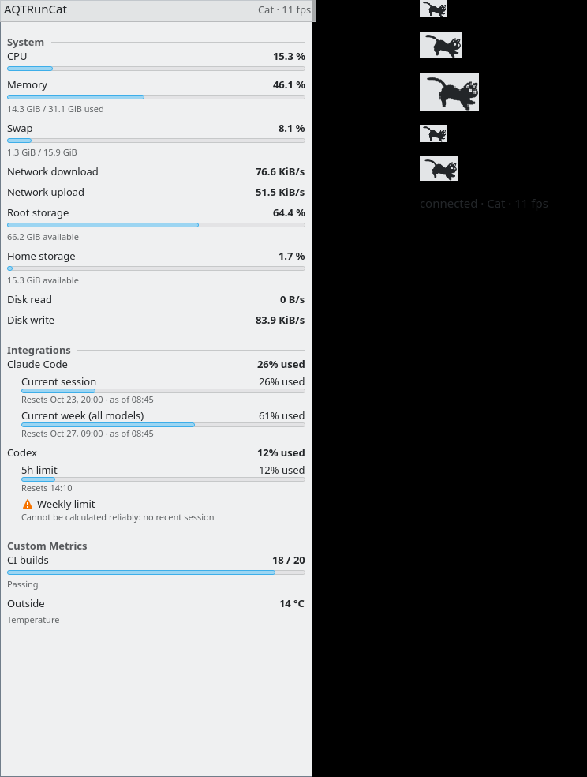
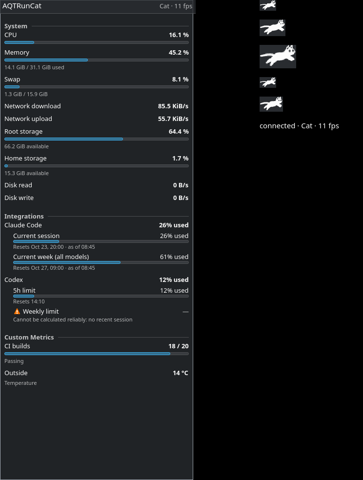

# AQTRunCat — F4.2 Plasmoid nativo per KDE Plasma 6

F4 è diviso in due parti:

- **F4.1**: il backend headless `aqtruncatd`, l'API D-Bus e la CLI
  `aqtruncatctl` (`docs/backend-dbus-api-cli.md`);
- **F4.2** (questo documento): il widget nativo per KDE Plasma 6, un
  **frontend** di quel backend, accanto al frontend Qt/SNI e mai al suo
  posto.

```text
                     aqtruncatd  (F4.1, unico motore)
               metriche · Custom Metrics · Claude/Codex · fps
                                    │
                    D-Bus di sessione, io.github.psykedady.AQTRunCat1
                 ┌──────────────────┼─────────────────────┐
           aqtruncat run       Plasmoid (F4.2)        aqtruncatctl,
          (tray Qt/SNI,      io.github.psykedady.     altri client
           Qt Widgets)        aqtruncat (QML,
                              Kirigami, Plasma)
```

Il Plasmoid non campiona CPU o memoria, non legge i file di Claude Code o
Codex, non esegue comandi Custom Metrics, non ha uno scheduler e non ha un
proprio archivio delle impostazioni: tutto lo stato viene dal backend.

## 1. Analisi iniziale

Ho letto il codice F4.1 prima di decidere (contratto in
`src/api/apischema.*`, servizio in `src/api/backendservice.*`, client Qt in
`src/api/backendclient.*`). In sintesi:

- l'API espone `GetState`, `GetMetrics`, `GetRunner`, `GetSettings`,
  `GetIntegrations`, `SetSetting` e gli altri metodi di scrittura, più i
  segnali `MetricsChanged(generation, changes)`, `RunnerChanged`,
  `SettingsChanged` e `IntegrationsChanged`;
- i client recuperano lo stato con `GetState`, seguono i delta per
  `generation` e tornano a `GetState` dopo un salto o un nuovo proprietario
  del nome; il backend si avvia con la **D-Bus activation**;
- il backend calcola gli fps del runner, ma **non conosce i runner**: i
  fotogrammi li carica il frontend Qt dalla propria qrc (bundled) o dalla
  cartella XDG dell'utente, con validazione e test "monocromatico" in C++
  (QtGui);
- la classificazione `builtin` / `integration` / `custom` è già nel campo
  `category` di ogni metrica.

Ambiente di sviluppo verificato: Arch, **Plasma 6.8.0** (libplasma,
plasma-workspace), KDE Frameworks 6.31 (Kirigami, KCMUtils), Qt 6.12.0,
Plasma SDK 6.8.0 (`plasmoidviewer`), Wayland, eDP a scala 1,25.

## 2. Strategia: pacchetto QML puro

Opzioni valutate:

| | A — **pacchetto QML puro** (scelta) | B — QML + plugin C++ (modulo QML o `Plasma::Applet`) |
|---|---|---|
| Installazione | file in `share/plasma/plasmoids/<id>`: Plasma li trova in `/usr/share`, `/usr/local/share` e `~/.local/share` (XDG) | il plugin deve stare in una cartella di plugin/QML di Qt: `/usr/lib/qt6/...` va bene per i pacchetti, ma **`/usr/local` e `--local` non vengono cercati** da plasmashell senza variabili d'ambiente |
| Dipendenze di build | nessuna (nessun KF6/Qt Declarative per compilare) | Qt Qml/Quick (+ libplasma per un applet C++) |
| Rischio per plasmashell | nessun codice nativo caricato nel processo | codice nativo nel processo di plasmashell (un crash lo porta giù) |
| Riuso | D-Bus via il modulo QML di Plasma `org.kde.plasma.workspace.dbus` | `BackendClient` C++ |

Ho scelto **A** perché è l'unica opzione che funziona con tutte le modalità
dell'installer (sistema `/usr/local`, `--local`, pacchetti), è la forma
standard dei widget di terze parti di Plasma 6 e non carica codice nativo
in plasmashell. L'adattatore QML↔IPC è `BackendClient.qml`.

Per l'unica funzione mancante (i runner) ho aggiunto un'estensione
generica e compatibile all'API, `GetRunners` (§4): non è specifica del
Plasmoid e serve a qualsiasi client che non usi la libreria runner Qt (GTK,
Waybar, …).

## 3. Pacchetto

```text
plasmoid/package/                        → share/plasma/plasmoids/io.github.psykedady.aqtruncat/
├── metadata.json                        KPackageStructure Plasma/Applet, Id, Version 1.4.2,
│                                        X-Plasma-API-Minimum-Version 6.0
└── contents/
    ├── code/logic.js                    funzioni pure sui payload dell'API (testate)
    ├── config/main.xml                  opzioni del solo widget (KConfigXT)
    ├── config/config.qml                pagine: "AQTRunCat" e "Appearance"
    └── ui/
        ├── main.qml                     PlasmoidItem: compatta/estesa, tooltip
        ├── BackendClient.qml            client D-Bus (stato, delta, recupero, scritture)
        ├── CompactRepresentation.qml    il runner nel pannello
        ├── RunnerView.qml               animazione locale dei fotogrammi
        ├── FullRepresentation.qml       il popup (PlasmaExtras.Representation)
        ├── MetricDelegate.qml           una metrica, con voci multiple
        ├── configGeneral.qml            impostazioni condivise via API
        └── configAppearance.qml         opzioni del widget
```

Moduli QML usati (tutti di Plasma 6 / KF6 / Qt 6): `org.kde.plasma.plasmoid`,
`org.kde.plasma.core`, `org.kde.plasma.components`, `org.kde.plasma.extras`,
`org.kde.plasma.workspace.dbus`, `org.kde.kirigami`, `org.kde.kcmutils`,
`QtQuick.Dialogs`. Versione minima: **Plasma 6.0** (il modulo D-Bus di
plasma-workspace esiste dalla serie 6); validato su 6.8.0.

## 4. Integrazione con il backend

### 4.1 Client (`BackendClient.qml`)

- Tutte le chiamate sono **asincrone** (`DBus.SessionBus.asyncCall`): il
  thread della UI di plasmashell non aspetta mai il backend.
- Avvio: `GetState` con autostart → la **D-Bus activation** avvia
  `aqtruncatd` se non c'è. Il QML non può avviare processi: il ripiego "avvia
  il backend accanto a sé" del tray non esiste nel Plasmoid; serve il file
  di attivazione installato (vedi §11).
- Aggiornamenti: `DBus.SignalWatcher` sul nome noto (segue anche un backend
  riavviato) per `MetricsChanged`, `RunnerChanged`, `SettingsChanged`,
  `IntegrationsChanged`; `DBus.DBusServiceWatcher` per il proprietario del
  nome.
- Delta (`logic.js` `deltaAction`): stessa generazione → ignorato;
  successiva → applicata; salto **o generazione più bassa** (un backend
  riavviato riparte da 1) → `GetState`. Un `order` con id sconosciuti →
  `GetState`.
- **Popup chiuso**: i delta delle metriche non vengono letti né
  analizzati (si aggiorna solo la generazione); all'apertura un
  `GetMetrics` riporta le metriche allo stato corrente. Runner, fps e
  impostazioni restano sempre aggiornati.
- Backend perso: 3 s di tolleranza senza sfarfallio, poi stato
  `unavailable` con messaggio; nuovi tentativi a 3 s, poi 6, 12, fino a
  30 s (nessun ciclo stretto); un nuovo proprietario del nome viene preso
  subito.
- API di un'altra versione maggiore: stato `incompatible`, nessun altro
  tentativo finché il nome non cambia proprietario. Backend senza la
  capability `runners` (AQTRunCat 1.4.1): funziona, il pannello mostra
  l'icona di AQTRunCat al posto del runner e il popup lo segnala.
- Più widget (pannelli, desktop): ognuno ha il suo client, i segnali sono
  broadcast; il backend è uno solo (attivazione idempotente) e il suo
  lavoro non cambia col numero di client.

### 4.2 Estensione dell'API: `GetRunners` (capability `runners`)

`GetRunners() → s`, schema 1, compatibile (nuovo metodo e nuova
capability; nessun payload esistente cambia):

```json
{"schema":1, "requested":"gone", "selected":"cat", "defaultRunnerId":"cat",
 "runners":[{"id":"cat", "displayName":"Cat", "author":"…", "source":"bundled",
             "valid":true, "error":"", "monochrome":true,
             "frameWidth":56, "frameHeight":36,
             "frames":["/usr/local/share/aqtruncat/runners/cat/cat-frame-0.png", …],
             "sequence":[0,1,2,3,4], "warnings":[]}, …]}
```

- `frames`: percorsi assoluti dei PNG, nell'ordine dei file; `sequence`:
  ordine di riproduzione (indici in `frames`, `frameOrder` dei metadati);
- `monochrome`: dal `type` dei metadati o dal test sui pixel, esattamente
  come il tray (stesso `loadRunner`);
- `selected`: il runner che un frontend mostra per il `runnerId` salvato,
  con lo **stesso ripiego** del tray all'avvio (`selectStartupRunner`:
  runner mancante o non valido → runner predefinito);
- i runner bundled vengono ora installati **anche come file** in
  `share/aqtruncat/runners/<id>/` (gli stessi PNG non modificati di
  `third_party/`, vedi `THIRD_PARTY_NOTICES.md`); il backend li cerca in
  `../share/aqtruncat/runners` accanto al proprio eseguibile, poi nelle
  cartelle dati XDG. Il tray continua a usare la sua qrc.

Il caricamento dei runner richiede QtGui (`QImageReader`): la funzione sta
in una libreria separata (`aqtruncat_runner_catalog`) linkata **solo** da
`aqtruncatd` e dal tray, iniettata in `BackendService` come
`Config::runnerCatalog`. `aqtruncat_api` e `aqtruncatctl` restano QtCore +
QtDBus (verificato con `ldd`). `aqtruncatd` ora linka QtGui solo per
decodificare i PNG: non crea una `QGuiApplication`, non carica plugin di
piattaforma e gira senza sessione grafica (verificato senza `DISPLAY` né
`WAYLAND_DISPLAY`). RSS misurato: ~23 MB dopo una `GetRunners` (17–18 MB in
F4.1).

`GetRunners` decodifica i runner a ogni chiamata (pochi ms); il Plasmoid la
chiama all'avvio, quando cambia `runnerId` e all'apertura della pagina di
configurazione. Un runner importato dopo compare nella lista alla
successiva apertura della configurazione.

## 5. Rappresentazione compatta (pannello)

- Solo il runner, senza testo né sfondo (trasparente).
- **Pannello orizzontale**: altezza = spessore del pannello, larghezza =
  altezza × rapporto d'aspetto del runner (`frameWidth/frameHeight`);
  **verticale**: larghezza = spessore, altezza = larghezza / aspetto;
  **desktop**: il riquadro più grande con l'aspetto del runner, centrato.
  Nessun ritaglio, nessun padding superfluo.
- **Animazione locale** (`RunnerView.qml`): ogni fotogramma è disegnato
  una sola volta in un proprio `Canvas`, in pixel del dispositivo (HiDPI
  nitido; ridisegnato solo se cambiano dimensione, colore o scala dello
  schermo). Un tick del timer cambia solo quale `Canvas` è visibile:
  nessuna decodifica, nessuna allocazione, nessun traffico D-Bus per
  fotogramma. Intervallo = `round(1000 / fps)` con gli fps di
  `RunnerChanged`; un cambio di fps mantiene la posizione (come
  `RunnerAnimator`).
- Runner **monocromatici**: alfa conservato, colore = testo del tema di
  Plasma (`Kirigami.Theme.textColor`, composizione *source-in*, la stessa
  del tray); runner a **colori**: disegnati così come sono.
- Timer fermo quando il widget non è visibile, quando gli fps sono 0,
  quando il backend non c'è (il runner resta fermo e semitrasparente) e
  con l'opzione "Animate the runner" spenta.
- Clic, Spazio o Invio aprono/chiudono il popup; il nome accessibile è
  "AQTRunCat", la descrizione è il tooltip (runner o stato del backend).
  Il tooltip non contiene metriche (F6 non è in questo scope).
  *Nota successiva (F6, 1.6.3):* il tooltip ora riporta anche CPU, RAM e
  swap; vedi `docs/hover-information.md`.

Nota tecnica: `Kirigami.Icon` non colora i PNG da file e arrotonda le
dimensioni alle misure delle icone, e `MultiEffect` non viene reso senza
GPU (rendering software, offscreen): per questo il `Canvas`.

## 6. Popup (rappresentazione estesa)




(Anteprime offscreen generate con `tools/plasmoid-preview.sh`, dati
dimostrativi: le integrazioni Claude Code e Codex sono finte, il secondo
limite di Codex "non calcolabile". A destra il runner alle dimensioni dei
pannelli orizzontali 22/34/48 px e verticali 34/48 px.)

- `PlasmaExtras.Representation` con `PlasmoidHeading` (titolo, runner e
  fps, pulsante "Configure" del widget) e una `ListView` in
  `PlasmaComponents.ScrollView`: il popup standard di Plasma, come quelli
  di Rete o Volume, non una finestra Qt Widgets e non una copia della
  Dashboard.
- Sezioni **System**, **Integrations**, **Custom Metrics** dal solo campo
  `category`; una categoria vuota o nascosta non ha sezione.
- Ogni metrica: titolo, valore del backend (`formattedValue`), barra solo
  se c'è `normalized`, riga di dettaglio (`detail`). Le metriche
  multivalore (finestre di quota Claude/Codex, snapshot con più voci)
  elencano le voci, ognuna con barra, riga di reset e avviso. Una metrica
  con una sola voce diventa una riga sola.
- Stati: `pending` → "…" e il messaggio del backend; `unavailable` → "—",
  icona di avviso e messaggio; `error` (e qualsiasi stato sconosciuto) →
  "—", icona di errore e messaggio; voce con `warning` (dati vecchi, valore
  non calcolabile) → icona di avviso, "—" se non c'è valore, e il
  dettaglio. **Nessun valore mancante diventa 0 e nessuna percentuale
  viene inventata.**
- Backend in avvio, assente o incompatibile: `PlaceholderMessage` con il
  motivo e "Retry".
- Dimensioni: minimo 16 × 12 grid unit, preferite 22 × 26 (seguono font e
  scala); colori, font e spaziature dal tema di Plasma.

## 7. Impostazioni

Due pagine nella finestra di configurazione standard del widget:

**AQTRunCat** (`configGeneral.qml`) — le impostazioni condivise
dell'unico `AQTRunCat.ini`, scritte con `SetSetting` e con i metodi delle
integrazioni e delle Custom Metrics; si applicano subito (sono le stesse
della finestra Settings del tray e di `aqtruncatctl`) e ogni modifica
fatta altrove compare qui grazie a `SettingsChanged`:

- runner (dal catalogo; i runner non validi sono elencati disabilitati,
  con il motivo), velocità (Normal / Slow down);
- rete: automatica o scelta manuale delle interfacce;
- integrazioni Claude Code e Codex: abilitazione e live updates
  (`SetIntegrationEnabled`, `SetIntegrationLiveUpdates`), con lo stato
  dell'adattatore;
- Custom Metrics: elenco, rimozione dei file registrati, aggiunta di un
  file (`RegisterCustomMetric`, che li valida);
- stato della connessione al backend.

Restano al tray (indicato nella pagina): avvio al login, Metrics Bar e
cadenza della Dashboard. Il Plasmoid **non** può aprire la finestra
Settings del tray (non esiste un'API per chiederlo a un tray in
esecuzione, e avviarlo abiliterebbe il frontend Qt/SNI).

**Appearance** (`configAppearance.qml`, `contents/config/main.xml`) —
opzioni del solo widget, per istanza, con Apply/OK di Plasma: animare il
runner, mostrare System / Integrations / Custom Metrics, righe di
dettaglio. Nessuna di queste duplica un'impostazione del backend.

## 8. Coesistenza con il frontend Qt/SNI

| Qt/SNI | Plasmoid | Risultato |
|---|---|---|
| attivo | non aggiunto | esperienza tray invariata |
| non avviato | aggiunto | il Plasmoid attiva il backend via D-Bus |
| attivo | aggiunto | entrambi leggono lo stesso backend (un solo `aqtruncatd`) |
| — | — | il backend parte solo su richiesta (CLI, altri client) |

Installare il widget non abilita il tray e non tocca l'autostart (che
riguarda solo il tray); abilitare il tray non aggiunge il widget. Il
Plasmoid non nasconde né disattiva il tray.

## 9. Installazione

`install.sh` (stesse garanzie di M9–F4.1: sistema o `--local`, manifest,
disinstallazione sicura, dati utente intatti, chiusura dei processi di
quella installazione, `--no-build` con la domanda sulla versione):

| Opzione | Plasma 6 trovato | Plasma 6 non trovato |
|---|---|---|
| (nessuna) | applicazione + widget | solo applicazione |
| `--plasmoid` | applicazione + widget | **errore**, niente cambiato: moduli mancanti e comando dei pacchetti della distribuzione |
| `--no-plasmoid` | solo applicazione (un widget installato prima da questa installazione viene rimosso) | solo applicazione |

- "Plasma 6 trovato" = tutti i moduli QML di Qt 6 usati dal widget sono
  presenti (`qmldir` sotto `QT_INSTALL_QML` o i percorsi soliti) e
  `org.kde.plasma.plasmoid` è della serie 6. Non serve una sessione Plasma
  attiva: `--plasmoid` installa anche da una sessione diversa.
- Il widget fa parte di ogni build (`AQTRUNCAT_INSTALL_PLASMOID`, ON: sono
  solo file QML); l'installer lo tiene o lo toglie dall'albero di staging,
  quindi anche `--no-build` installa esattamente ciò che è stato deciso.
  Una build riusata di una versione precedente senza widget: avviso (o
  errore con `--plasmoid`).
- `--dry-run` mostra la decisione: `plasmoid = true (default: KDE Plasma
  6.8.0 found)`, `false (--no-plasmoid)`, `false (default: KDE Plasma 6 not
  found, missing …)`.
- Destinazioni: `<prefix>/share/plasma/plasmoids/io.github.psykedady.aqtruncat/`
  o `${XDG_DATA_HOME:-~/.local/share}/plasma/plasmoids/…`; più
  `share/aqtruncat/runners/`.
- Se `XDG_DATA_DIRS` della sessione non contiene la cartella dati di un
  prefisso di sistema (es. `--prefix=/opt/aqtruncat`), l'installer avvisa:
  Plasma non troverebbe il widget e D-Bus non troverebbe il backend.
- **Installare il pacchetto e aggiungere un'istanza sono operazioni
  separate**: l'installer non aggiunge il widget a pannelli o desktop, non
  modifica la configurazione di Plasma e non riavvia né chiude plasmashell.
  Un widget già presente usa la versione aggiornata dal successivo avvio di
  Plasma (login); l'installer lo dice.
  *Nota (2026-10-22, F5, su richiesta dell'utente):* dopo l'aggiornamento di
  un widget già installato, con Plasma in esecuzione, l'installer ora
  **chiede** su terminale se riavviare Plasma (default N; opzioni
  `--restart-plasma` / `--no-restart-plasma`). Pannelli e layout restano
  intatti. Dettagli: `docs/additional-built-in-metrics.md` §5.5.
- Disinstallazione: rimuove solo i file del manifest (widget compreso) e le
  cartelle di AQTRunCat rimaste vuote; un widget non correlato nella stessa
  cartella e la disposizione dei pannelli non vengono toccati. Un widget
  AQTRunCat rimasto su un pannello compare come non disponibile:
  l'installer lo segnala.

### Aggiungere il widget

Tasto destro su un pannello o sul desktop → **Aggiungi o gestisci
oggetti…** (Add or Manage Widgets…) → cerca **AQTRunCat** → trascinalo sul
pannello o sul desktop (oppure doppio clic). Per toglierlo: tasto destro sul
widget → Rimuovi.

## 10. Pacchetti nativi

Scelta: il widget è una **parte del pacchetto esistente**, non un pacchetto
separato. Sono una decina di file QML/JS (~40 kB) senza alcuna dipendenza di
build; un pacchetto in più complicherebbe le tre ricette per nulla, e senza
Plasma i file restano inerti. Le dipendenze di Plasma sono **deboli**, così
gli utenti non KDE non installano niente di Plasma:

| Ricetta | Modifica |
|---|---|
| PKGBUILD | `optdepends`: `plasma-workspace: the AQTRunCat widget for KDE Plasma 6 panels and desktop` |
| RPM | `Suggests: plasma-workspace`; `%files` con `%{_datadir}/%{name}/` e `%{_datadir}/plasma/plasmoids/io.github.psykedady.aqtruncat/` |
| Debian | `Suggests: plasma-workspace` |

plasma-workspace porta con sé libplasma, Kirigami, KCMUtils e Qt
Declarative. Versione 1.4.2 in CMake, ricette, changelog, pagina man e
`metadata.json` (controllata da `packaging-versions`). Come per F4.1, i
pacchetti sono verificati come layout, non ricostruiti nei container delle
distribuzioni.

## 11. Sicurezza e privacy

- Solo l'API locale sul bus di sessione; nessun listener di rete, nessuna
  richiesta HTTP, nessun token.
- Il QML non legge file dei provider, non esegue comandi (nessun
  `Plasma5Support`/`executable`), non usa il bus di sistema e non legge
  `/proc` o `/sys`; i soli metodi chiamati sono quelli dell'API (verificato
  dal test `plasmoidpackage`). I file letti sono i PNG dei runner elencati
  dal backend.
- I comandi Custom Metrics restano quelli dei file dell'utente: il widget
  può solo registrare/rimuovere un file, che il backend valida come fa per
  Settings; le integrazioni accettano id noti e argomenti fissi.
- Nessun log dei payload: il Plasmoid non scrive nulla nel journal.

## 12. Prestazioni

Misure su `/proc/<pid>/stat` (utime+stime), 30 s per scenario, 8 CPU
logiche, Plasma 6.8 / Wayland reale, `plasmoidviewer` (l'intero processo di
visualizzazione, che include l'animazione del runner) su bus privato con il
backend della build e un'integrazione dimostrativa:

| Scenario | CPU |
|---|---|
| Plasmoid da solo, popup chiuso | viewer 0,23–0,27 %, backend 0,07–0,10 % |
| Plasmoid da solo, popup aperto | viewer 0,27 %, backend 0,07–0,10 % |
| Plasmoid + tray Qt | viewer 0,23–0,27 %, tray 0,07 %, backend 0,10 % |
| due widget + tray | viewer 0,27 % + 0,27–0,30 %, tray 0,07 %, backend 0,07–0,10 % |
| riferimento F4.1: tray + backend (tray reale nel pannello) | tray 0,47 %, backend 0,07 % |

- `MetricsChanged`: 10–12 in 10 s con due widget e il tray, la stessa
  cadenza di un solo client (F4.1: 40 in 30 s): **nessun campionamento
  doppio**, un solo `aqtruncatd`.
- All'avvio un widget fa una `GetState` e una `GetRunners`; a un cambio di
  runner una `GetRunners` per widget; nessuna chiamata per fotogramma.
- Il tray in questa prova non aveva un host SNI sul bus privato (le icone
  non venivano mostrate), quindi il suo costo è più basso di quello reale.
- In plasmashell il costo del widget si somma al processo di plasmashell;
  non è stato misurato dentro la sessione dell'utente (vedi §14).

## 13. Test automatici

| Test | Cosa verifica |
|---|---|
| `plasmoidlogic` (qmltestrunner, 15 casi) | `logic.js`: valori incapsulati del modulo D-Bus, stati (sconosciuto = errore), classificazione solo da `category`, mai 0 inventati, voci multiple Claude/Codex e avvisi, voce singola, icone, generazioni dei delta, applicazione dei delta, aggiornamento minimo del modello, scelta del runner e fotogrammi, intervallo, capability |
| `plasmoidclient` (C++ + QQmlEngine, 10 casi, bus privato con attivazione) | il vero `BackendClient.qml` col vero `aqtruncatd`: attivazione su richiesta, tre client = un backend, chiusura di un widget senza fermare il backend, classificazione, Custom Metrics registrate dal widget, delta identici al backend, popup chiuso senza analisi dei delta, impostazioni in entrambe le direzioni (widget → INI e altri client; CLI → widget, runner compreso), scritture rifiutate, riavvio del backend (tolleranza, `unavailable`, tentativi, riconnessione, generazioni da 1), backend 1.4.1 senza `runners`, backend con API 2, pagine di configurazione; **nessun warning QML** dai file del pacchetto |
| `plasmoidpackage` (C++, 9 casi) | metadati Plasma 6, struttura, schema di configurazione e pagine, regole frontend-only (nessun comando, rete, file dei provider; solo metodi dell'API); caricamento reale in `plasmoidviewer` (offscreen, bus privato, backend della build) in un pannello orizzontale, verticale e sul desktop senza alcun messaggio QML dai file del pacchetto |
| `backendipc` (+1 caso) | `GetRunners`: capability, file e ordine, monocromatico/colore, runner utente valido e non valido, ripiego del runner selezionato |
| `installer` (275 controlli, +58) | rilevamento di Plasma 6 (moduli mancanti, Plasma 5), decisione e `--dry-run`, `--plasmoid` senza Plasma (errore, niente cambiato), installazione locale e di sistema, aggiornamento, `--no-plasmoid` che rimuove il widget, disinstallazione, widget non correlato e layout dei pannelli intatti, nessuna chiamata a plasmashell/kpackagetool, avviso `XDG_DATA_DIRS` |
| `packaging-versions` | anche `metadata.json` del widget |

I test che richiedono strumenti opzionali si registrano solo se ci sono
(`qmltestrunner`, Qt Qml, `dbus-run-session`); `loadsInPlasma` si salta
senza `plasmoidviewer`. Nessun test usa la sessione Plasma, i pannelli o i
dati reali dell'utente.

## 14. Validazione runtime (Plasma 6.8 / Wayland)

Fatta senza toccare plasmashell, i pannelli, il bus di sessione o i dati
dell'utente: bus privato (`dbus-run-session` senza cartelle di servizi),
HOME e XDG temporanei, backend della build, finestre `plasmoidviewer` sul
compositor reale (contenitore pannello `org.kde.panel` e desktop).

Verificato:

1. il widget si carica (pannello orizzontale, verticale, desktop) senza
   messaggi QML dai suoi file, anche dopo minuti di esecuzione;
2. all'avvio una `GetState` e una `GetRunners`, poi solo segnali;
3. popup e runner renderizzati (offscreen, temi Breeze chiaro e scuro,
   scala 1 e 2: immagini sopra), colorazione dei runner monocromatici,
   proporzioni ai vari spessori di pannello;
4. metriche built-in, integrazioni (con avviso "non calcolabile") e Custom
   Metrics nelle loro sezioni;
5. il backend funziona senza il tray; con il tray e due widget resta uno
   solo, con la stessa cadenza di segnali (nessun campionamento doppio);
6. un cambio di runner dalla CLI arriva a entrambi i widget (una
   `GetRunners` ciascuno);
7. backend fermato e riavviato: i widget e il tray ritentano e si
   ricollegano;
8. nessun crash; nessun processo o file temporaneo residuo.

Durante la validazione è emerso un warning visibile solo sul compositor
reale ("Binding loop detected for property rightPadding" dello
ScrollView del popup), corretto legando `contentWidth` allo spazio
disponibile come fanno i widget di Plasma; un test ha inoltre trovato
un'eccezione JavaScript quando una risposta D-Bus arrivava dopo la
rimozione del widget (corretta).

**Verifica manuale dell'utente (2026-10-21):** il Plasmoid è stato avviato
nella sessione Plasma reale ed è risultato corretto; F4 è stato chiuso
ufficialmente. Elenco originale dei controlli lasciati alla verifica
manuale:

- aggiungere il widget a un pannello reale (Add or Manage Widgets) e a un
  desktop; aprire e chiudere il popup col clic (in `plasmoidviewer` il
  popup non si può aprire senza input: l'interazione via AT-SPI non è
  stata possibile perché il bus di accessibilità non era raggiungibile
  dall'ambiente di prova);
- l'aspetto nel pannello reale con il tema dell'utente, pannello
  verticale, auto-hide e spessori diversi;
- il costo CPU dentro plasmashell con il widget sul pannello.

## 15. Risoluzione dei problemi

| Sintomo | Causa / rimedio |
|---|---|
| "AQTRunCat" non compare in Add Widgets | widget non installato (Plasma 6 non trovato? `./install.sh --dry-run`), oppure prefisso non in `XDG_DATA_DIRS` |
| "AQTRunCat backend not running" | file di attivazione non riletto: dopo l'installazione l'installer chiede `ReloadConfig`; altrimenti un nuovo login, oppure avvia una volta `aqtruncatctl status` / `aqtruncat` |
| "Incompatible AQTRunCat backend" | è in esecuzione un backend di un'altra versione maggiore dell'API: chiudilo (`aqtruncatctl status` dice quale) |
| icona al posto del runner + nota nel popup | backend 1.4.1 senza `GetRunners`: aggiorna AQTRunCat (l'installer chiude il backend vecchio) |
| dopo un aggiornamento il widget sul pannello è vecchio | Plasma ricarica il QML al successivo avvio (login) |
| runner nuovo non in lista | riapri la configurazione del widget |

## 16. Limitazioni note

- Il widget dipende dalla D-Bus activation (nessun ripiego di avvio dal
  QML): con un prefisso non cercato da D-Bus, o prima del `ReloadConfig`
  con dbus-broker, il backend parte solo dopo un login o con il tray/CLI.
- Nessuna traduzione (come il resto di AQTRunCat; stringhe in inglese).
- Le icone `symbol` (nomi SF Symbols di RunCat Neo) non hanno un
  equivalente Plasma e non vengono mostrate; le icone `theme` e `file` sì.
- La finestra Settings del tray non si apre dal widget; le impostazioni
  solo-tray sono indicate nella pagina di configurazione.
- `GetRunners` non ha un segnale di variazione: un runner importato compare
  alla riapertura della configurazione o al prossimo cambio di runner.
- Un pannello nascosto (auto-hide) non ferma l'animazione: Plasma non lo
  espone al widget.
- `org.kde.plasma.workspace.dbus` è un modulo QML di plasma-workspace, non
  di KDE Frameworks: un cambiamento futuro in Plasma potrebbe richiedere un
  adeguamento.
